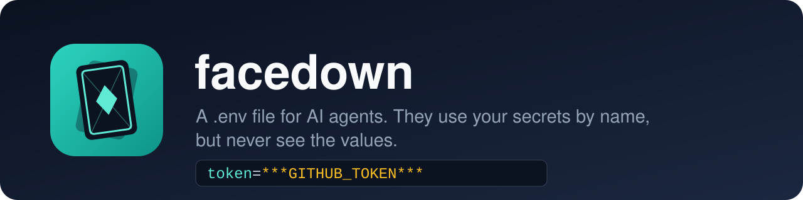
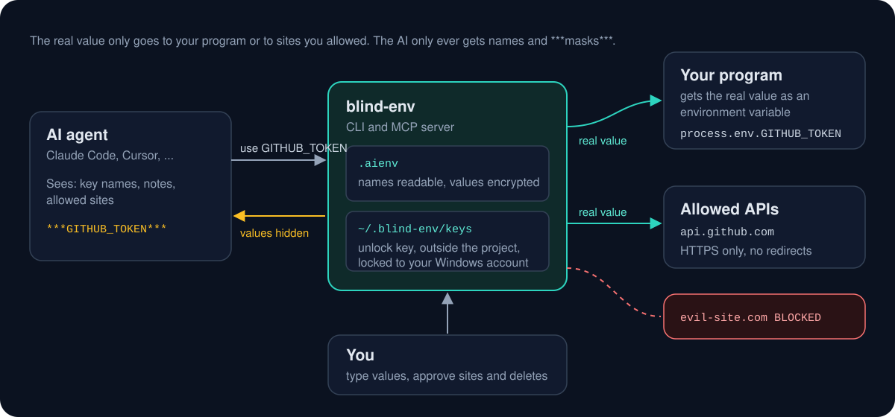
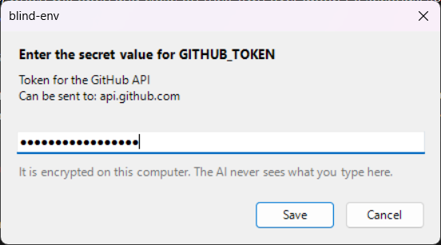
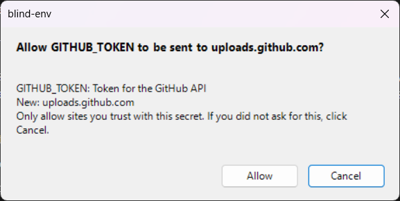
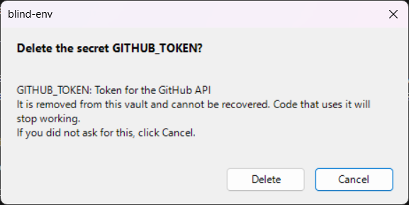
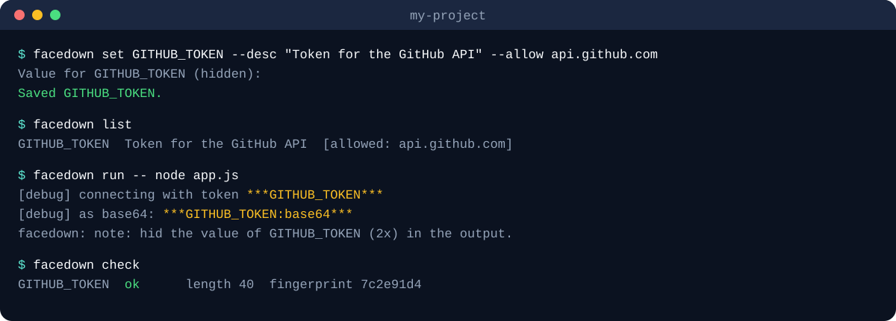

<p align="center">
  
</p>

<p align="center">
  <a href="https://github.com/necromancer124/blind-env/actions/workflows/test.yml"></a>
  <a href="https://www.npmjs.com/package/blind-env"></a>
  
  
  
  <a href="LICENSE"></a>
</p>

AI coding agents read your project files. If your `.env` holds passwords and
API keys, the AI sees them in plain text, and they end up in chat
transcripts, logs and sometimes in code.

**blind-env** is a `.env` file the AI can **use** but never **read**. It sees
which secrets exist and what they are for, and it can run your code or call an
API with them. The real values go straight to your program or to the sites you
allowed, never to the AI.

```
You:     /addKey GITHUB_TOKEN token for the GitHub API
         → a private window opens on your screen, you type the value there
Claude:  Saved GITHUB_TOKEN.

You:     list my GitHub repos
Claude:  ▶ http_request  Authorization: Bearer {{GITHUB_TOKEN}}
         → blind-env fills in the real token, sends the request,
           and hides the token in whatever comes back
```

> **Status: v0.1 preview. Windows for now; Linux and macOS are planned.**
> Needs Node 20 or newer, no other dependencies.

## How it works

<p align="center">
  
</p>

Secrets live in one file in your project, `.aienv`:

```ini
# blind-env vault v1 id=Qm9iX2lk

# @desc token for the GitHub API
# @allow api.github.com
GITHUB_TOKEN=enc:v2:8kZ0…

# @desc Postgres password (local)
DB_PASSWORD=enc:v2:Lw91…
```

- **Names, notes and allowed sites are plain text.** The AI reads them to know
  what exists.
- **Values are encrypted** (AES-256-GCM). The unlock key is *not* in the
  project: it is in your home folder (`~/.blind-env/keys/`), and on Windows it
  is locked to your Windows account.
- **There is no command that prints a value.** A secret only ever goes to the
  environment of a program you run, or into a web request to a site you
  allowed.
- **Logs show the key name, not the value.** If a program prints a secret it
  comes out as `***GITHUB_TOKEN***`, also when it was base64, hex or URL
  encoded first.
- **You approve the risky steps.** Typing a value, allowing a new site and
  deleting a secret all happen in a window on your screen.

## Install

You need [Node.js](https://nodejs.org) 20 or newer.

**Claude Code** (the MCP server plus five slash commands, in every project).
Type this in Claude Code:

```
/plugin install blind-env --marketplace necromancer124/blind-env
```

On Claude Code older than 2.1.275, use two steps instead:

```
/plugin marketplace add necromancer124/blind-env
/plugin install blind-env@blind-env
```

Then start a new session.

**Command line:**

```bash
npm install -g blind-env
```

Or run it without installing: `npx blind-env help`.

**From source:**

```bash
git clone https://github.com/necromancer124/blind-env
```
```bash
cd blind-env
```
```bash
npm link
```

## Use it in Claude Code

| Command | What it does |
|---|---|
| `/addKey NAME what it is for` | Opens a password window. You type the value; Claude never sees it. |
| `/keys` | Lists names, notes and allowed sites. Never values. |
| `/allowSite NAME api.example.com` | Lets a key be sent to a site. You confirm in a window first. |
| `/removeSite NAME api.example.com` | Stops a key being sent to a site. |
| `/removeKey NAME` | Deletes a secret. You confirm in a window first. |

Everything else you just ask for in plain words ("use GITHUB_TOKEN to list my
repos"), and Claude uses the blind-env tools.

<table>
  <tr>
    <td width="33%"></td>
    <td width="33%"></td>
    <td width="33%"></td>
  </tr>
  <tr>
    <td align="center"><b>/addKey</b>: you type the value</td>
    <td align="center"><b>/allowSite</b>: you approve new sites</td>
    <td align="center"><b>/removeKey</b>: you approve deletes</td>
  </tr>
</table>

In the windows, Enter means **Cancel**: approving always takes a click.

## Use it in a terminal

<p align="center">
  
</p>

```bash
blind-env set GITHUB_TOKEN --desc "token for the GitHub API" --allow api.github.com
```

You type the value with hidden input. If there is no terminal to ask in, the
password window opens instead.

```bash
blind-env run -- node app.js
```

`app.js` reads `process.env.GITHUB_TOKEN` as usual. Add `--keys A,B` to pass
only some keys. Your code can be in any language: it is just an environment
variable.

| Command | What it does |
|---|---|
| `blind-env init` | Create a `.aienv` vault in this folder (`set` does it for you) |
| `blind-env set NAME` | Add or replace a secret (`--desc`, `--allow`, `--stdin`) |
| `blind-env list` | Names, notes and allowed sites (`--json`) |
| `blind-env check` | Confirms each secret decrypts; shows length and a fingerprint |
| `blind-env run -- cmd` | Run a command with the secrets as environment variables |
| `blind-env allow NAME site…` | Set the allowed sites (adding one asks you first) |
| `blind-env rm NAME` | Delete a secret (asks you first) |
| `blind-env mcp` | Start the MCP server for AI agents |

### Debugging: printing a secret is allowed

Your code can log a secret like any other variable. The log shows which key it
was instead of the value, and how it was encoded:

```
[debug] connecting with token ***GITHUB_TOKEN*** | as base64: ***GITHUB_TOKEN:base64***
blind-env: note: hid the value of GITHUB_TOKEN (2x) in the output. Logs show the key name instead of the value.
```

- `--quiet` drops the note line.
- `--strict` treats a printed secret as an error and fails the run with exit
  code 97. Set `BLIND_ENV_STRICT=1` to make every run strict.

`blind-env check` shows a fingerprint that stays the same until the value
changes, so you can tell "still the old token" from "the new one" at a glance.
It is made with the vault key and the key name, so it cannot be used to guess
the value.

### Allowed sites

A key can only be sent (with `http_request`) to the sites on its list. A new
key has an empty list.

```bash
blind-env allow GITHUB_TOKEN api.github.com
```

- `allow` sets the whole list, so name every site you want.
- `*.github.com` covers every subdomain (not `github.com` itself).
- `blind-env allow NAME --clear` removes all sites.
- **Adding a site to a saved secret always asks you first**, in a confirmation
  window on Windows (or a y/N question in a terminal elsewhere), even when an
  AI runs the command. Removing sites needs no confirmation.
- `set NAME --allow site` sets the sites together with a **new** value, so no
  window asks about them: a value already stored is never sent anywhere new
  this way. When you type the new value in the password window, new sites are
  marked `NEW` there.
- The list is protected by the encryption: if someone adds a site by editing
  `.aienv` by hand, that key stops working instead of being sent there.

## For other AI agents (MCP server)

`blind-env mcp` is a standard MCP server, so any agent that speaks MCP can use
it. Without the plugin, for Claude Code in your project folder:

```bash
claude mcp add blind-env -- blind-env mcp
```

The agent gets six tools:

| Tool | What it does |
|------|--------------|
| `list_keys` | Which vault file is in use, plus names, notes and allowed sites. Never values. |
| `add_key` | Opens a private window where **you** type the value. |
| `run_with_secrets` | Runs a command with the chosen keys as environment variables (in `cmd.exe` on Windows, so `%NAME%`). Output is cleaned. The command also gets the AI app's own environment variables, which blind-env does not hide. |
| `http_request` | Sends a web request with `{{KEY_NAME}}` filled in. Only to allowed sites, HTTPS only, redirects not followed, response cleaned. |
| `allow_hosts` | Adds or removes allowed sites. Adding opens a confirmation window; nothing changes unless **you** click Allow. |
| `remove_key` | Deletes a secret. Opens a confirmation window; nothing is deleted unless **you** click Delete. |

If you open this repo itself in Claude Code, `.mcp.json` and
`.claude/commands/` give you the server and the commands without installing
anything. Start the session in the repo folder: a session that starts
elsewhere does not load them until it moves into the repo.

## What it protects, and what it does not

**It does protect against:**

- secret values ending up in the chat, the AI's memory, transcripts or logs;
- the AI reading secrets from a file in your project;
- a program printing a secret by accident;
- a web page tricking the AI into sending a key to the wrong site through
  `http_request`.

An allowed site is trusted with the key. If you allow `api.github.com`, the AI
could still send the token there in a way that stores it, for example inside a
new gist. Allow only the API a key is for, and keep `run_with_secrets` and
`http_request` approvals in Claude Code switched on for anything sensitive.

**It does not protect against an AI that has a shell and is trying to steal a
secret.** An agent that can run any command as you can write a program that
scrambles the secret before printing it (so the cleaner misses it), sends it to
a server, unlocks the key file the same way blind-env does, or even "click" the
confirmation window with simulated key presses. Nothing running under your own
account can fully stop that.

So think of blind-env as a seat belt, not a vault door: it stops the common,
accidental ways secrets leak to an AI. The strongest setup is an agent that has
**only** the `http_request` tool and no shell. Then the allowed-sites list is a
real barrier.

Other limits:

- Values must be at least 8 characters. Hiding a short value gives it away
  (`test` masked inside `testing` shows what it is), so shorter ones are
  refused unless `--allow-short` is given. Only use that for things that
  really are short, like a PIN: a short value is easy to spot in output, and
  values under 4 characters are not hidden at all.
  Key names are never masked, even when a value appears inside one.
- The vault only opens on the computer and account that created it. On a new
  machine, add the secrets again.
- The windows exist on Windows only. On Linux and macOS use `blind-env set
  NAME` in a terminal; those platforms are untested.

Found a security problem? See [SECURITY.md](SECURITY.md).

## Tests

```bash
npm test
```

The tests run on every push on Windows with Node 20, 22 and 24. The full manual
test, written as a prompt for an AI session, is in
[docs/TEST-PROMPT.md](docs/TEST-PROMPT.md).

## Roadmap

- Linux and macOS: keychain protection for the key, and the windows
- `login` tool: fill a username and password into a browser form
- Move a vault to another computer
- "This key may only be used by this command" rules for `run_with_secrets`

## License

MIT, see [LICENSE](LICENSE).
